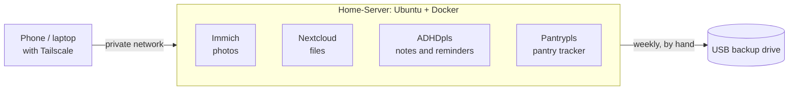

# Home-Server

A small, private home server that one person built from an old tower PC: photos, files, a pantry tracker and an ADHD dashboard, reachable only from their own devices, backed up to a USB drive. This repo shows the layout and holds the backup script. The point is simple: **you can do this, and it does not need to be fancy.**

## The big picture



| Piece | What it is | Repo |
|---|---|---|
| Server | Any always-on PC running Ubuntu or similar, with Docker and Compose | this one |
| Private access | [Tailscale](https://tailscale.com/), so nothing is open to the internet | |
| Photos | [Immich](https://immich.app/) | upstream |
| Files | [Nextcloud](https://nextcloud.com/) | upstream |
| Notes and reminders | ADHDpls | `adhdpls` |
| Pantry tracker | Pantrypls | `pantrypls` |
| Backups | `backup/Home-Server-backup.sh` | this one |

## Three rules the setup follows

1. **Nothing faces the internet.** Every service is reached over a private network. Publish container ports on a specific private address (for example `100.x.y.z:5056:5056`) rather than relying on the host firewall, because [Docker's documentation](https://docs.docker.com/engine/network/packet-filtering-firewalls/) says published ports can bypass firewall tools like `ufw`.
2. **Data lives in one folder.** Everything the containers store sits under a single path (here `/srv/data`), so a backup is "copy that folder, plus dump the databases".
3. **A backup you have not looked at is a hope, not a backup.** The script checks its own dumps and prints a per-step summary.

## The backup script

`backup/Home-Server-backup.sh` copies a Docker server to an external drive.

| Step | What happens |
|---|---|
| Immich database | `pg_dump` inside the container, compressed, then checked (valid gzip, has the PostgreSQL header, not tiny) |
| Immich photos | `rsync` of the upload folder, after the database, as the [Immich backup docs](https://docs.immich.app/administration/backup-and-restore/) advise |
| Nextcloud | [Maintenance mode](https://docs.nextcloud.com/server/latest/admin_manual/maintenance/backup.html) on, database dump and file copy, maintenance mode off (also off if the script is interrupted or fails) |
| Compose and `.env` files | Copied so the containers can be rebuilt |
| SQLite apps | Each `.db` file copied with SQLite's backup API, because copying a live database file can give a damaged copy |
| Tidy | Deletes only dated database dumps this script made, older than `KEEP_DAYS` |

Safety built in:

- It **never deletes your files** from the backup drive (no `--delete`).
- It refuses to run unless the drive's label matches `DRIVE_LABEL`, so it cannot write to the wrong disk.
- It checks the drive is writable and has enough free space before starting.
- A failed dump is never saved as if it were good, and one failed step does not stop the others.
- `--check` looks around and reports, changing nothing.

### Set it up

```bash
cp backup/backup.conf.example backup/backup.conf
nano backup/backup.conf                      # set DRIVE_LABEL and your paths
lsblk -o NAME,LABEL,SIZE,FSTYPE              # find your drive's label
sudo mount /dev/sdX1 /mnt/backup             # mount it (read-write)
sudo bash backup/Home-Server-backup.sh --check   # dry look, writes nothing
sudo bash backup/Home-Server-backup.sh           # the real thing
```

Every setting is in `backup.conf` (`backup.conf` is git-ignored, so your names stay private).

### Notes for NTFS drives

If the drive is NTFS (common when it already holds a lifetime of files), Linux owners and permissions are **not** stored. That is fine for a backup, but after copying files back to a server you must set their ownership again. The script uses `rsync -rt --no-perms --no-owner --no-group` for this reason. Mounting by hand (not in `/etc/fstab`) means a missing drive can never hold up boot.

### Test it without touching anything real

```bash
bash tests/rehearsal.sh
```

This runs the real script against a fake server folder with stand-in `docker`, `rsync` and drive commands (19 checks): the dry run writes nothing, a full run produces dumps and copies, a wrong or missing drive label is refused, a failed dump leaves nothing bad behind, and old dumps are pruned while unrelated files stay.

## Honest limits

- **The restore has not been tested yet.** The backups run and their dumps validate, but nobody has rebuilt a server from them. Do a restore test before you trust it.
- The author runs it by hand, weekly. A 2.5-inch USB drive is not meant to stay plugged in around the clock, so there is no timer.
- The backup stays on-site. There is no off-site copy yet, so a fire or theft takes both.
- The `.env` copies hold passwords. Keep the drive somewhere safe.
- Written for Immich v3.2.x and Nextcloud in Docker with a Postgres container. Other layouts need different container names (all configurable) or different steps.

## License

MIT, see `LICENSE`.
